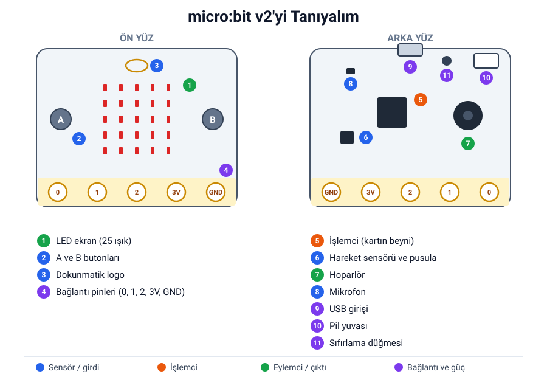
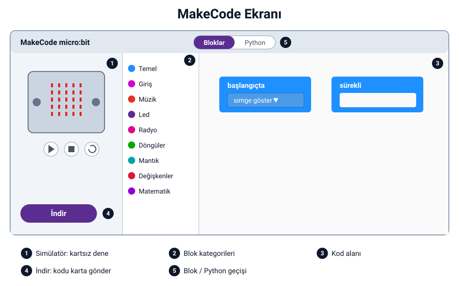
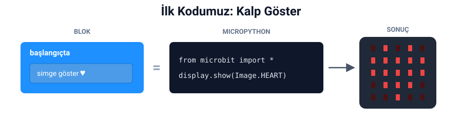
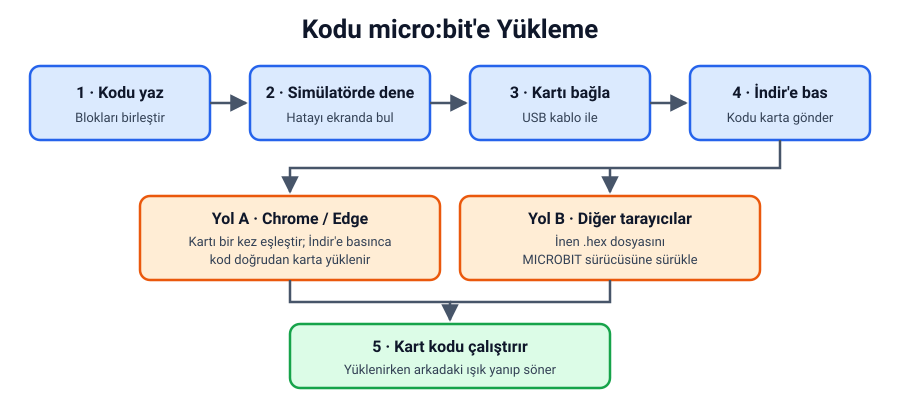

## Bu hafta ne öğreneceğiz?

Geçen hafta robotun sensör, işlemci ve eylemciden oluştuğunu öğrendik. Bu hafta bu üç parçayı micro:bit kartının üzerinde bulacak, ilk kodumuzu yazacak ve karta yükleyeceğiz.

**Malzemeler:** micro:bit v2 kartı, micro USB kablosu, bilgisayar (Chrome veya Edge tarayıcısı önerilir). İsteğe bağlı: 2 adet AAA pilli pil yuvası.

---

## 1. micro:bit nedir?

micro:bit, avuç içi büyüklüğünde, programlanabilen küçük bir bilgisayardır. Dünyanın birçok ülkesinde okullarda kodlama öğrenmek için kullanılır. Üzerinde sensörler, bir işlemci ve eylemciler bulunduğu için tek başına küçük bir robot beyni gibi çalışır.



<small>Kart görselleri: [microbit.org](https://microbit.org)</small>

| Parça | Ne işe yarar? | Robot parçası |
| --- | --- | --- |
| A ve B butonları | Basıldığını algılar | Sensör |
| Dokunmatik logo | Dokunulduğunu algılar | Sensör |
| Hareket sensörü ve pusula | Sallama, eğme ve yönü algılar | Sensör |
| Mikrofon | Sesi algılar | Sensör |
| İşlemci | Kodu çalıştırır, karar verir | İşlemci |
| LED ekran (25 ışık) | Simge, yazı ve sayı gösterir | Eylemci |
| Hoparlör | Ses ve melodi çalar | Eylemci |
| USB girişi, pil yuvası | Kartı bilgisayara bağlar, güç verir | Bağlantı |
| Bağlantı pinleri | Başka parçalar takmamızı sağlar | Bağlantı |

:::tip[Gizli sensörler]
Kartta ayrı bir ışık sensörü göremezsin, çünkü LED'ler ışığı ölçmek için de kullanılır. Sıcaklık sensörü ise işlemcinin içine gizlenmiştir!
:::

**Etkinlik – Kartı keşfet:** Kartını eline al ve görseldeki 11 parçayı kartın üzerinde bul. Her parçayı bulduğunda sensör mü, işlemci mi, eylemci mi olduğunu arkadaşına söyle.

:::caution[Kartı korumak için]
Kartı kenarlarından tut. Pinleri metal yüzeylere değdirme ve kartı ıslak elle tutma.
:::

---

## 2. MakeCode'u açalım

Kodlarımızı **makecode.microbit.org** adresinde yazacağız. Kurulum gerekmez, tarayıcıda çalışır.

1. Tarayıcıda **makecode.microbit.org** adresini aç.
2. Dil Türkçe değilse sağ üstteki dişli simgesinden **Dil** seçeneğini bulup **Türkçe**'yi seç.
3. **Yeni Proje** düğmesine bas ve projene bir ad ver (örneğin "Kalp").



| No | Bölüm | Ne işe yarar? |
| --- | --- | --- |
| 1 | Simülatör | Kodun kartta nasıl çalışacağını ekranda gösterir |
| 2 | Blok kategorileri | Blokları renklerine göre gruplar: Temel, Giriş, Müzik… |
| 3 | Kod alanı | Blokları sürükleyip birleştirdiğimiz yer |
| 4 | İndir düğmesi | Kodu micro:bit kartına gönderir |
| 5 | Blok / Python geçişi | Aynı kodu metin olarak gösterir (2. dönemde kullanacağız) |

Yeni projede kod alanında iki blok hazır gelir:

- **başlangıçta:** İçindeki kod, kart açıldığında **bir kez** çalışır.
- **sürekli:** İçindeki kod, kart açık olduğu sürece **tekrar tekrar** çalışır.

---

## 3. İlk kodumuz: Kalp göster

1. **Temel** kategorisine tıkla.
2. **simge göster** bloğunu sürükleyip **başlangıçta** bloğunun içine bırak.
3. Bloktaki simgeye tıklayıp kalbi seç.
4. Simülatöre bak: Ekranda kalp belirdi!



**Kalbi attıralım:** Şimdi **sürekli** bloğunun içine iki tane **simge göster** bloğu koy. Birincisinde büyük kalbi, ikincisinde küçük kalbi seç. Kart açık olduğu sürece kalp atmaya başlar.

MicroPython'da aynı kod şöyle görünür (bunu 2. dönemde öğreneceğiz):

```python
from microbit import *

while True:
    display.show(Image.HEART)
    sleep(500)
    display.show(Image.HEART_SMALL)
    sleep(500)
```

:::tip[Daha hızlı ya da yavaş]
Kalp atışını yavaşlatmak için **Temel** kategorisindeki **duraklat (ms)** bloğunu iki simgenin arasına ekle. 1000 ms, 1 saniye demektir.
:::

---

## 4. Simülatörde test et

Simülatör, kartı bilgisayar ekranında taklit eder. Kartın olmadığı yerde de kodunu deneyebilirsin.

- Kodu değiştirdiğinde simülatör kendiliğinden yeniden başlar.
- Simülatördeki A ve B butonlarına fareyle tıklayabilirsin.
- Kare düğme simülatörü durdurur, dönen ok baştan başlatır.

**Altın kural:** Kodu karta yüklemeden önce mutlaka simülatörde dene. Hatayı ekranda bulmak daha kolaydır.

---

## 5. Kodu karta yükle



1. micro:bit kartını USB kablosuyla bilgisayara bağla.
2. **İndir** düğmesine bas.
3. Tarayıcına göre iki yoldan birini izle:
    - **Yol A – Chrome veya Edge:** MakeCode kartı eşleştirmeni önerir. Ekrandaki adımları izleyip kartını seç. Bundan sonra **İndir**'e her bastığında kod doğrudan karta gider.
    - **Yol B – Diğer tarayıcılar:** Bilgisayara `.hex` uzantılı bir dosya iner. Dosya gezgininde **MICROBIT** adlı sürücüyü bul ve dosyayı bu sürücünün üzerine sürükle.
4. Yükleme sırasında kartın arkasındaki ışık yanıp söner. Işık durunca kalp ekranda belirir.

:::note[Pil ile çalıştırma]
Kodu yükledikten sonra kabloyu çıkarıp pil yuvasını takarsan kart kodu çalıştırmaya devam eder. Kod, yeni bir kod yükleyene kadar kartta kalır.
:::

**Sorun giderme:**

| Sorun | Çözüm |
| --- | --- |
| Bilgisayar kartı görmüyor | Başka bir kablo dene; bazı kablolar yalnızca şarj içindir |
| Kod yüklendi ama çalışmıyor | Kartın arkasındaki sıfırlama düğmesine bas |
| Ekranda farklı bir şey görünüyor | Kodu simülatörde kontrol et, yeniden yükle |
| İndir'e basınca hiçbir şey olmuyor | Yol B'yi dene: inen dosyayı MICROBIT sürücüsüne sürükle |

---

## Kendini dene

1. **Temel** kategorisindeki **LED'leri göster** bloğuyla kendi simgeni çiz ve karta yükle.
2. **yazı göster** bloğuyla adının ilk harfini ekranda kaydır.
3. **sürekli** bloğunun içinde 3 farklı simgeden oluşan bir animasyon yap.
4. Kodunu bir arkadaşının kartına yükle. Onun kartında da aynı şekilde çalışıyor mu?

---

## Mini quiz

1. micro:bit ekranında kaç LED vardır?
   a) 16  b) 25  c) 36
2. Kodu kartsız denemek için ne kullanırız?
   a) Simülatör  b) Pil yuvası  c) Pinler
3. **başlangıçta** bloğundaki kod ne zaman çalışır?
   a) Sürekli tekrar eder  b) Kart açıldığında bir kez  c) Butona basınca
4. Aşağıdakilerden hangisi bir eylemcidir?
   a) A butonu  b) Hoparlör  c) Hareket sensörü
5. Kodu karta yüklemek için kart bilgisayara nasıl bağlanır?
   a) USB kablo  b) HDMI kablo  c) Kulaklık kablosu

<details>
<summary>Cevap anahtarı</summary>

1-b · 2-a · 3-b · 4-b · 5-a

</details>

---

## Öğretmen notu

- **1. ders saati:** 1. haftanın kısa tekrarı (5 dk), kartı keşfet etkinliği (15 dk), MakeCode arayüzü (5 dk), ilk kod simülatörde (15 dk).
- **2. ders saati:** Kodu karta yükleme (15 dk), kalp atışı animasyonu (10 dk), kendini dene görevleri (10 dk), mini quiz (5 dk).
- Dersten önce tüm kartları ve kabloları deneyin. Yalnızca şarj kablolarıyla en çok vakit kaybedilir.
- Okul bilgisayarlarında Chrome veya Edge yoksa Yol B'yi baştan anlatın. İnen dosyanın nereye kaydedildiğini birlikte bulun.
- Kartları ve kabloları numaralandırıp her öğrenci çiftine aynı numarayı verin. Hangi kartın arızalı olduğunu bulmak kolaylaşır.
- Kartı keşfet etkinliğini 1. haftadaki renklerle bağlayın: sensörler mavi, işlemci turuncu, eylemciler yeşil.
- Dersi bitirmeden öğrencilerden kodlarını karttan silmelerini istemeyin; bir sonraki sınıf kendi kodunu yüklediğinde eski kod kendiliğinden silinir.
