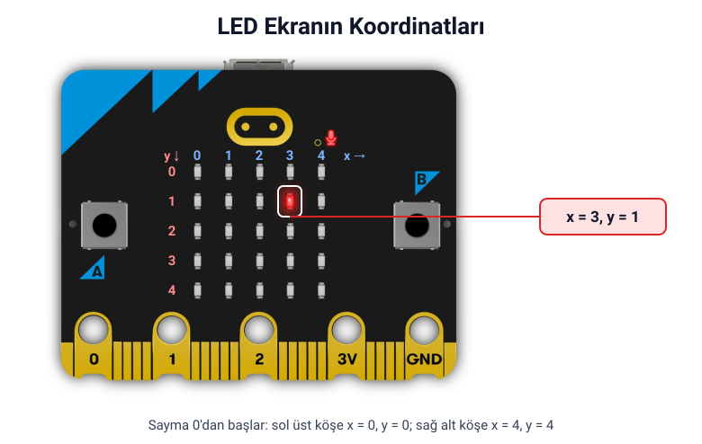
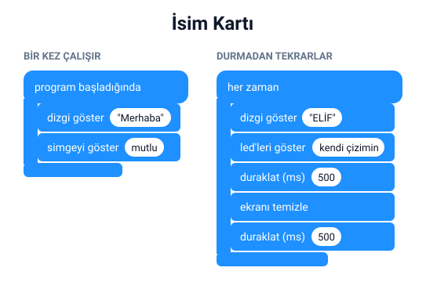

## Bu hafta ne öğreneceğiz?

Geçen hafta ekranda bir kalp gösterdik. Bu hafta LED ekranı yakından tanıyacak; kendi simgelerimizi çizecek, adımızı kaydıracak ve küçük animasyonlar yapacağız.

**Malzemeler:** micro:bit v2, USB kablo, bilgisayar. Bilgisayarsız etkinlik için kareli kâğıt ve kırmızı kalem.

---

## 1. LED ekran nasıl çalışır?

micro:bit ekranı 5 sütun ve 5 satırdan oluşan **25 LED**'den yapılmıştır. Her LED'in bir adresi vardır: **x** soldan sağa sütunu, **y** yukarıdan aşağı satırı gösterir.



<small>Kart görseli: [microbit.org](https://microbit.org)</small>

:::tip[Dikkat: sayma 0'dan başlar]
Bilgisayarlar saymaya genellikle 0'dan başlar. Bu yüzden ilk sütun x = 0, son sütun x = 4'tür.
:::

<div class="etkinlik">
<strong>Bilgisayarsız etkinlik – Piksel oyunu:</strong> Kareli kâğıda 5x5'lik bir kare çiz. Arkadaşın sana koordinatlar söylesin ("x = 2, y = 0"), sen o kareyi boya. Sonunda hangi resim çıktı?
</div>

Tek bir LED'i yakmak için **LED** kategorisindeki **led yak** bloğunu kullanırız: x ve y değerlerini yazarız, o LED yanar.

---

## 2. Hazır simgeler

**Temel** kategorisindeki **simgeyi göster** bloğunda kalp, mutlu yüz, üzgün yüz, ok, ördek, ev gibi hazır çizimler vardır. Bloktaki küçük resme tıklayıp istediğini seçebilirsin.

---

## 3. Kendi çizimin: led'leri göster

Hazır simgeler yetmezse **led'leri göster** bloğuyla kendi resmini çizersin. Bloktaki 25 kareden yanmasını istediklerine tıkla; tıklanan kareler kırmızı olur.

<div class="etkinlik">
<strong>Etkinlik:</strong> Önce kareli kâğıtta bir simge tasarla (güneş, ağaç, baş harfin…), sonra <strong>led'leri göster</strong> bloğuyla ekrana aktar.
</div>

---

## 4. Yazı ve sayı göstermek

| Blok | Ne yapar? | Örnek |
| --- | --- | --- |
| dizgi göster | Yazıyı ekranda sağdan sola kaydırır | "Merhaba" |
| sayıyı göster | Sayıyı gösterir; birden çok basamaklıysa kaydırır | 7, 2026 |
| ekranı temizle | Tüm LED'leri söndürür | — |

:::note[Türkçe karakterler]
micro:bit ekranı ç, ğ, ı, ö, ş, ü harflerini gösteremeyebilir. Yazılarında bu harfler yerine c, g, i, o, s, u kullanmayı dene.
:::

---

## 5. Animasyon yapmak

Çizgi filmler, art arda gösterilen resimlerden oluşur. Her resme **kare** denir. micro:bit'te de birkaç simgeyi art arda göstererek animasyon yaparız.

- **duraklat (ms):** Bir sonraki kareye geçmeden bekler. 1000 ms = 1 saniye.
- **her zaman** bloğunun içine koyduğun animasyon hiç durmadan tekrar eder.

---

## 6. Proje: İsim kartı

Kart açıldığında "Merhaba" yazsın, sonra sürekli olarak adını ve kendi çizdiğin simgeyi göstersin.



**Canlı dene:** <a href="https://makecode.microbit.org/_ELP3HDU8Xbx4" target="_blank" rel="noopener noreferrer">Bu projeyi MakeCode'da aç</a> ve simülatörde çalıştığını gör.

MicroPython'da aynı fikir şöyle yazılır:

```python
from microbit import *

display.scroll("Merhaba")
display.show(Image.HAPPY)

while True:
    display.scroll("ELIF")
    display.show(Image("09090:99999:99999:09990:00900"))
    sleep(500)
    display.clear()
    sleep(500)
```

`Image("09090:...")` içindeki her rakam bir LED'in parlaklığıdır: 0 sönük, 9 en parlak. İki nokta üst üste (:) yeni satıra geçer.

---

## Kendini dene

1. Kendi baş harfini **led'leri göster** ile çiz ve 1 saniye göster.
2. 3 karelik bir animasyon yap: örneğin küçük kare → büyük kare → boş ekran.
3. Bugünün tarihini **sayıyı göster** ile göster.
4. **led yak** bloğuyla ekranın dört köşesindeki LED'leri sırayla yak.

---

## Mini quiz

1. micro:bit ekranında kaç satır ve kaç sütun vardır?  
   a) 4 satır, 4 sütun  
   b) 5 satır, 5 sütun  
   c) 6 satır, 6 sütun
2. Sol üst köşedeki LED'in koordinatı nedir?  
   a) x = 1, y = 1  
   b) x = 0, y = 0  
   c) x = 5, y = 5
3. Kendi resmimizi çizmek için hangi bloğu kullanırız?  
   a) led'leri göster  
   b) dizgi göster  
   c) sayıyı göster
4. 1000 ms kaç saniyedir?  
   a) 10 saniye  
   b) 1 saniye  
   c) 100 saniye
5. Art arda gösterilen resimlerle oluşturulan harekete ne denir?  
   a) Koordinat  
   b) Animasyon  
   c) Değişken

<details>
<summary>Cevap anahtarı</summary>

1-b · 2-b · 3-a · 4-b · 5-b

</details>

---

## Öğretmen notu

- **1. ders saati:** LED ekran ve koordinatlar (10 dk), piksel oyunu (15 dk), hazır simgeler ve led'leri göster (15 dk).
- **2. ders saati:** Yazı ve sayı gösterme (10 dk), animasyon (10 dk), isim kartı projesi (15 dk), mini quiz (5 dk).
- Piksel oyunu için 5x5 kareli çalışma kâğıdı hazırlamak tasarım aşamasını hızlandırır; öğrenciler önce kâğıtta çizip sonra koda aktarır.
- Yazı kaydırma yavaştır. Öğrencilere kısa yazılar (3–5 harf) kullanmalarını önerin, yoksa test etmek uzun sürer.
- Blok ve simge adları MakeCode sürümüne göre biraz farklı görünebilir; dersten önce kendi ekranınızda kontrol edin.
