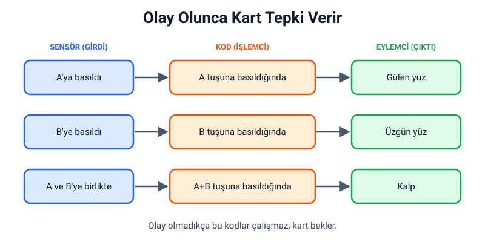
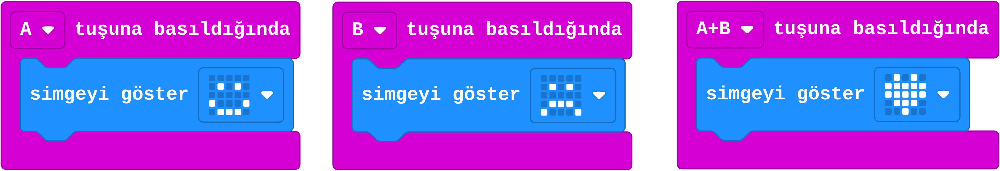
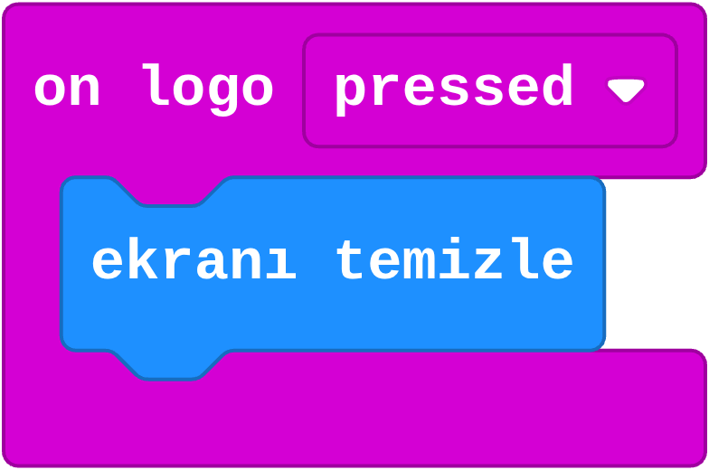

## Bu hafta ne öğreneceğiz?

Şimdiye kadar kodumuz kart açılınca kendi kendine çalıştı. Bu hafta karta **biz** komut vereceğiz: bir butona basınca kart bize cevap verecek.

**Malzemeler:** micro:bit v2, USB kablo, bilgisayar. İsteğe bağlı: pil yuvası.

---

## 1. Olay nedir?

**Olay**, bir şeyin gerçekleşmesidir: zilin çalması, kapının açılması, bir butona basılması. Bilgisayarlar olayları bekler ve olay olunca belirli bir kodu çalıştırır.

**Günlük hayattan örnekler:**

| Olay | Tepki |
| --- | --- |
| Zil çaldı | Kapıyı açarız |
| Trafik ışığı yeşil yandı | Karşıya geçeriz |
| Asansör düğmesine basıldı | Asansör gelir |

micro:bit'te de durum aynıdır: **A tuşuna basıldığında** ne yapacağını biz söyleriz.

---

## 2. Girdi, işlem, çıktı

1. haftada öğrendiğimiz robot parçalarını hatırla. Buton bir **sensördür**: basıldığını algılar. Kod **işlemcide** çalışır ve karar verir. Ekran bir **eylemcidir**: sonucu gösterir.



---

## 3. Buton olay blokları

**Girdi** kategorisinde (mor renkli) olay blokları bulunur. Olay blokları **program başladığında** veya **her zaman** bloğunun içine konmaz; kod alanında tek başına durur.

| Blok | Ne zaman çalışır? |
| --- | --- |
| A tuşuna basıldığında | A butonuna basılıp bırakılınca |
| B tuşuna basıldığında | B butonuna basılıp bırakılınca |
| A+B tuşuna basıldığında | İki butona birlikte basılınca |
| on logo pressed | Kartın üstündeki logoya dokununca (yalnızca v2; bu blok Türkçe MakeCode'da da İngilizce görünür) |

:::tip[A+B'ye basmak]
İki butona aynı anda basmak biraz pratik ister. İki parmağını butonların üstüne koy ve birlikte bastır.
:::

---

## 4. Proje: Duygu gösteren kart

A butonuna basınca gülen yüz, B butonuna basınca üzgün yüz, ikisine birden basınca kalp gösteren bir kart yapalım.



1. **Girdi** kategorisinden **A tuşuna basıldığında** bloğunu kod alanına sürükle.
2. İçine **Temel** kategorisinden **simgeyi göster** koy ve mutlu yüzü seç.
3. Aynı işi B ve A+B için tekrarla. Bloğun üzerindeki A harfine tıklayarak B veya A+B seçebilirsin.
4. Simülatörde A ve B butonlarına tıklayarak dene, sonra karta yükle.

MicroPython'da butonları, bloklardaki **her zaman** gibi hiç durmadan dönen `while True` döngüsünde kontrol ederiz:

```python
from microbit import *

while True:
    if button_a.is_pressed() and button_b.is_pressed():
        display.show(Image.HEART)
    elif button_a.is_pressed():
        display.show(Image.HAPPY)
    elif button_b.is_pressed():
        display.show(Image.SAD)
```

---

## 5. Dokunmatik logo

micro:bit v2'nin üstündeki altın renkli logo dokunmayı algılar. **on logo pressed** bloğuyla üçüncü bir buton gibi kullanabilirsin.

**Örnek:** Logoya dokununca ekranı temizle; böylece duygu kartı "sıfırlanmış" olur.



---

## Kendini dene

1. Duygu kartına logoya dokununca şaşkın yüz gösteren bir olay ekle.
2. A'ya basınca adını, B'ye basınca yaşını gösteren bir "tanışma kartı" yap.
3. A'ya basınca sağa, B'ye basınca sola bakan bir ok göster.
4. Aynı butona iki ayrı olay bloğu koymayı dene. Ne oluyor? (İpucu: MakeCode buna izin veriyor mu?)

---

## Mini quiz

1. Butona basılması, olayların hangisine bir örnektir?  
   a) Girdi  
   b) Çıktı  
   c) İşlemci
2. Olay blokları hangi kategoridedir?  
   a) Temel  
   b) Girdi  
   c) Müzik
3. A+B olayı ne zaman çalışır?  
   a) Önce A'ya, sonra B'ye basınca  
   b) İki butona birlikte basınca  
   c) Kart açılınca
4. Duygu kartında ekran hangi robot parçasıdır?  
   a) Sensör  
   b) İşlemci  
   c) Eylemci
5. Dokunmatik logo hangi micro:bit sürümünde vardır?  
   a) Yalnızca v2  
   b) Yalnızca v1  
   c) Hiçbirinde

<details>
<summary>Cevap anahtarı</summary>

1-a · 2-b · 3-b · 4-c · 5-a

</details>

---

## Öğretmen notu

- **1. ders saati:** Olay kavramı ve günlük hayat örnekleri (10 dk), girdi-işlem-çıktı (10 dk), buton blokları ve ilk deneme (20 dk).
- **2. ders saati:** Duygu kartı projesi (20 dk), dokunmatik logo (5 dk), kendini dene (10 dk), mini quiz (5 dk).
- Isınma oyunu önerisi: "Öğretmen olay söyler, sınıf tepki verir." Örneğin "Elimi kaldırırsam ayağa kalkın." Olay ve tepki ilişkisini bedenle yaşatır.
- Öğrenciler olay bloklarını **her zaman** içine koymaya çalışabilir; MakeCode buna izin vermez. Bu, olay bloklarının bağımsız çalıştığını göstermek için iyi bir fırsattır.
- Duygu kartını sınıfta "bugün nasılsın?" panosu olarak kullanabilirsiniz.
