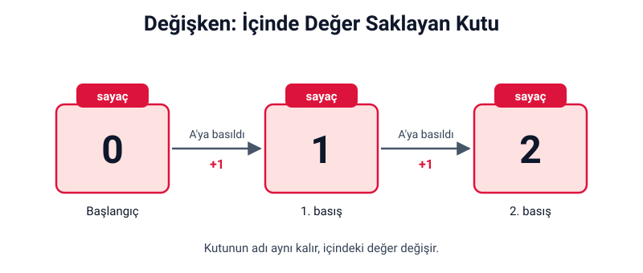
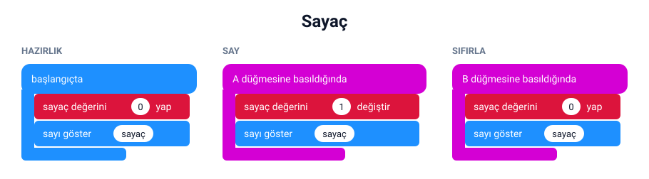

## Bu hafta ne öğreneceğiz?

Bir oyunda puanı, bir koşuda adım sayısını ya da sınıftaki öğrenci sayısını tutmak isteriz. Bilgisayarlar bu bilgileri **değişken** adı verilen yerlerde saklar. Bu hafta değişkenleri öğrenip bir sayaç yapacağız.

**Malzemeler:** micro:bit v2, USB kablo, bilgisayar. Bilgisayarsız etkinlik için üzerine ad yazılabilen küçük kutular veya kâğıt bardaklar.

---

## 1. Değişken nedir?

**Değişken**, içinde bir değer saklayan ve bir adı olan kutudur. Kutunun adı aynı kalır, içindeki değer değişebilir.



**Günlük hayattan örnekler:**

| Değişkenin adı | İçindeki değer | Nasıl değişir? |
| --- | --- | --- |
| puan | 12 | Gol atınca artar |
| sıcaklık | 24 | Hava ısındıkça artar |
| kalan süre | 30 | Her saniye azalır |

<div class="etkinlik">
<strong>Bilgisayarsız etkinlik – Kutu oyunu:</strong> Bir bardağa "puan" yaz. Öğretmen soru sorsun; doğru bilen grubun bardağına bir fasulye atılsın. Bardağın adı hep "puan" kalır ama içindeki fasulye sayısı değişir. İşte değişken budur!
</div>

---

## 2. Değişken oluşturmak

1. **Değişkenler** kategorisine (kırmızı) tıkla.
2. **Değişken Yarat...** düğmesine bas.
3. Değişkene anlamlı bir ad ver: `sayac`, `puan`, `adim` gibi.

:::tip[İyi değişken adları]
Değişkene içinde ne sakladığını anlatan bir ad ver. "a" yerine "puan" yazmak, kodunu okuyan herkesin işini kolaylaştırır. Python'a geçtiğimizde sorun yaşamamak için Türkçe karakter (ç, ğ, ı, ö, ş, ü) ve boşluk kullanma.
:::

---

## 3. Değişken blokları

| Blok | Ne yapar? | Örnek |
| --- | --- | --- |
| değişkenini … yap | Değişkene yeni bir değer verir | sayac değişkenini 0 yap |
| değişkenini … değiştir | Değeri artırır veya azaltır | sayac değişkenini 1 değiştir (1 artırır), −1 yazarsan 1 azaltır |
| değişkenin kendisi | Değişkenin o anki değerini verir | sayıyı göster bloğunun içine konur |

**Önemli:** Değişkene ilk değerini genellikle **program başladığında** bloğunda veririz. Buna değişkeni **hazırlamak** denir.

---

## 4. Proje: Sayaç

A butonuna her basışta 1 artan, B butonuna basınca sıfırlanan bir sayaç yapalım. Kantinde sıra sayarken, oyunda tur tutarken ya da tekrar sayarken kullanabilirsin.



**Canlı dene:** <a href="https://makecode.microbit.org/_Ch61TaP5DaU4" target="_blank" rel="noopener noreferrer">Bu projeyi MakeCode'da aç</a> ve simülatörde çalıştığını gör.

MicroPython'da değişken oluşturmak için adını yazıp **=** ile değer veririz:

```python
from microbit import *

sayac = 0
display.show(sayac)

while True:
    if button_a.was_pressed():
        sayac = sayac + 1
        display.scroll(sayac)
    if button_b.was_pressed():
        sayac = 0
        display.show(sayac)
```

:::note[Neden "sayac = sayac + 1"?]
Bu bir matematik eşitliği değildir. "Kutudaki değeri al, 1 ekle, sonucu tekrar kutuya koy" demektir.
:::

---

## Kendini dene

1. Sayacı 1 yerine 2'şer artır.
2. B butonu sıfırlamak yerine sayacı 1 azaltsın. Sayaç eksiye düşerse ne oluyor?
3. Logoya dokununca sayacın değerini kaydırarak göster.
4. İki değişkenli bir oyun yap: A'ya basınca `kirmizi`, B'ye basınca `mavi` takımın puanı artsın; A+B'ye basınca iki puan da sırayla gösterilsin.

---

## Mini quiz

1. Değişken nedir?  
   a) İçinde değer saklayan, adı olan kutu  
   b) Kartın bir parçası  
   c) Bir simge
2. Değişkene ilk değerini genellikle hangi blokta veririz?  
   a) her zaman  
   b) program başladığında  
   c) A tuşuna basıldığında
3. "sayac değişkenini 1 değiştir" bloğu ne yapar?  
   a) Sayacı 1 yapar  
   b) Sayacı 1 artırır  
   c) Sayacı siler
4. Hangisi daha iyi bir değişken adıdır?  
   a) x  
   b) puan  
   c) abc
5. sayac 4 iken "sayac değişkenini −1 değiştir" çalışırsa sayaç kaç olur?  
   a) 5  
   b) −1  
   c) 3

<details>
<summary>Cevap anahtarı</summary>

1-a · 2-b · 3-b · 4-b · 5-c

</details>

---

## Öğretmen notu

- **1. ders saati:** Kutu oyunu (15 dk), değişken kavramı ve örnekler (10 dk), değişken oluşturma ve bloklar (15 dk).
- **2. ders saati:** Sayaç projesi (20 dk), kendini dene (15 dk), mini quiz (5 dk).
- "yap" ile "değiştir" blokları en sık karıştırılan iki bloktur. Tahtaya iki kutu çizip birinde değeri silip yenisini yazarak, diğerinde üstüne ekleyerek gösterin.
- Çok basamaklı sayılar ekranda kayarak gösterilir ve zaman alır. Öğrenciler hızlı bastığında bazı basışlar "kaçmış" gibi görünebilir; bu, kaydırma sürdüğü için olur.
- Değişken adlarında Türkçe karakter kullanmama alışkanlığını şimdiden kazandırmak, 19. haftadaki Python geçişini kolaylaştırır.
