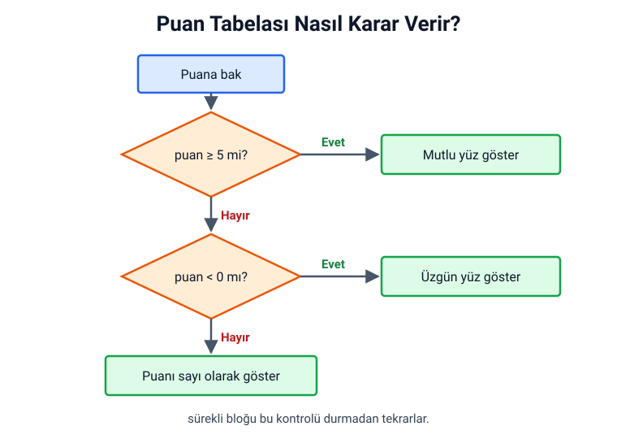
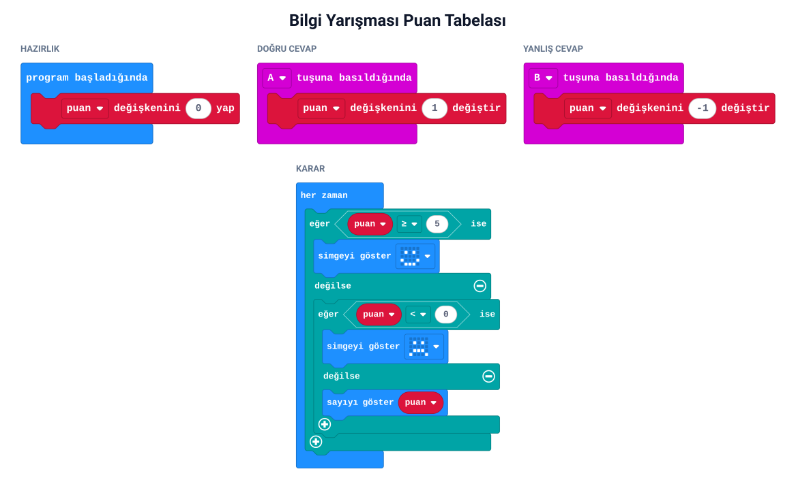

## Bu hafta ne öğreneceğiz?

Her gün kararlar veririz: "Hava yağmurluysa şemsiye alırım." Bu hafta micro:bit'e de karar verdirmeyi öğreneceğiz. Kart bir durumu kontrol edecek ve sonuca göre farklı şeyler yapacak.

**Malzemeler:** micro:bit v2, USB kablo, bilgisayar.

---

## 1. Koşul nedir?

**Koşul**, cevabı **doğru** ya da **yanlış** olan bir sorudur. Program, cevaba göre hangi yoldan gideceğine karar verir. 1. haftadaki akış şemasında bunu eşkenar dörtgenle (karar) göstermiştik.

| Koşul | Doğruysa | Yanlışsa |
| --- | --- | --- |
| Yağmur yağıyor mu? | Şemsiye al | Şemsiye alma |
| Saat 8'i geçti mi? | Koş | Yürü |
| Puan 5 veya daha fazla mı? | Kazandın | Devam et |

---

## 2. Eğer-ise ve eğer-değilse

**Mantık** kategorisinde (turkuaz renkli) iki temel blok vardır:

- **eğer … ise:** Koşul doğruysa içindeki kodu çalıştırır. Yanlışsa hiçbir şey yapmaz.
- **eğer … ise / değilse:** Koşul doğruysa birinci bölümü, yanlışsa **değilse** bölümünü çalıştırır.

Bloğun sol altındaki **+** işaretine basarak **yoksa eğer** bölümleri ekleyebilir, birden çok koşulu sırayla kontrol edebilirsin.

---

## 3. Karşılaştırma

Koşullarda iki değeri karşılaştırırız. Karşılaştırma blokları da **Mantık** kategorisindedir.

| İşaret | Anlamı | Örnek | Sonuç |
| --- | --- | --- | --- |
| = | eşittir | 3 = 3 | doğru |
| ≠ | eşit değildir | 3 ≠ 5 | doğru |
| < | küçüktür | 7 < 2 | yanlış |
| > | büyüktür | 7 > 2 | doğru |
| ≤ | küçük veya eşittir | 5 ≤ 5 | doğru |
| ≥ | büyük veya eşittir | 4 ≥ 5 | yanlış |

---

## 4. Proje: Bilgi yarışması puan tabelası

Sınıfta bilgi yarışması yapıyoruz. Her grubun bir micro:bit'i var:

- Grup doğru cevap verince **A**'ya basar, puanı 1 artar.
- Yanlış cevap verince **B**'ye basar, puanı 1 azalır.
- Puan 5'e ulaşınca kart mutlu yüz gösterir; puan eksiye düşerse üzgün yüz gösterir. Diğer durumlarda puanı gösterir.

Önce kararı akış şemasıyla çizelim:



Sonra bloklarla yazalım:



MicroPython'da `if`, `elif` (değilse eğer) ve `else` (değilse) kullanırız:

```python
from microbit import *

puan = 0

while True:
    if button_a.was_pressed():
        puan += 1
    if button_b.was_pressed():
        puan -= 1

    if puan >= 5:
        display.show(Image.HAPPY)
    elif puan < 0:
        display.show(Image.SAD)
    else:
        display.show(puan)
```

:::caution[Koşulların sırası önemli]
Kart koşulları yukarıdan aşağı sırayla kontrol eder ve ilk doğru olanı çalıştırır. Sıralı adımların önemini 1. haftada öğrenmiştik; burada da aynı kural geçerli.
:::

---

## Kendini dene

1. Kazanma puanını 5'ten 10'a çıkar.
2. Puan tam 3 olduğunda ekranda bir ok göstersin.
3. Puan 5'e ulaşınca A'ya basmak puanı artırmasın (puan 5'te dursun).
4. Kendi koşulunu kur: Logoya dokununca puan çift sayıysa kalp, tek sayıysa küçük kalp göstersin. (İpucu: **Matematik** kategorisindeki **remainder of** (bölümden kalan) bloğunu araştır.)

---

## Mini quiz

1. Koşulun cevabı ne olabilir?
   a) Yalnızca bir sayı  b) Doğru ya da yanlış  c) Bir simge
2. "eğer … ise / değilse" bloğunda koşul yanlışsa ne olur?
   a) Hiçbir şey olmaz  b) değilse bölümü çalışır  c) Kart kapanır
3. 6 ≥ 6 karşılaştırmasının sonucu nedir?
   a) doğru  b) yanlış  c) 12
4. Akış şemasında koşul hangi şekille gösterilir?
   a) Oval  b) Dikdörtgen  c) Eşkenar dörtgen
5. Koşul blokları hangi kategoridedir?
   a) Mantık  b) Döngüler  c) Müzik

<details>
<summary>Cevap anahtarı</summary>

1-b · 2-b · 3-a · 4-c · 5-a

</details>

---

## Öğretmen notu

- **1. ders saati:** Koşul kavramı ve "Eğer… ise" oyunu (10 dk), eğer-ise / değilse blokları (10 dk), karşılaştırmalar (10 dk), akış şemasını birlikte çizme (10 dk).
- **2. ders saati:** Puan tabelası projesi (20 dk), sınıf içi kısa bilgi yarışmasıyla deneme (10 dk), kendini dene ve mini quiz (10 dk).
- Isınma oyunu: "Eğer gözlüğün varsa ayağa kalk, değilse el çırp." Öğrenciler koşulu bedenleriyle uygular.
- Projeyi gerçek bir bilgi yarışmasıyla bitirin; soruları diğer derslerden seçebilirsiniz. Öğrenciler kendi yazdıkları puan tabelasını kullanınca motivasyon artar.
- ≥ ve > farkı sık karıştırılır. "Puan 5 olunca kazanır mı?" sorusuyla iki işareti denetin.
