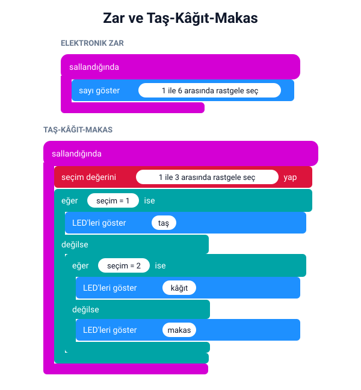
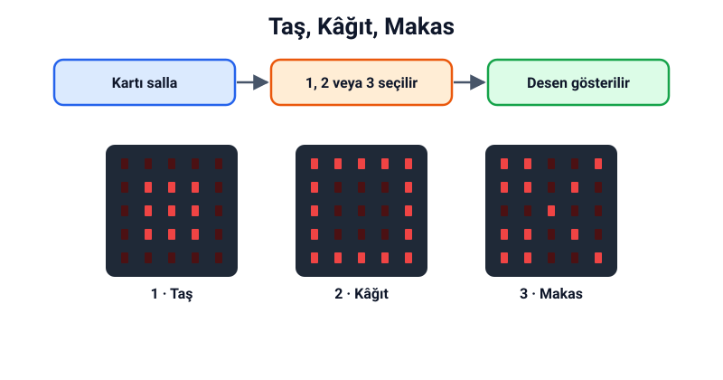

## Bu hafta ne öğreneceğiz?

Zar atmak, yazı-tura oynamak, torbadan kura çekmek… Sonucunu önceden bilemediğimiz durumlara **rastgele** deriz. Bu hafta micro:bit'e rastgele sayı seçtirip oyunlar yapacağız. Geçen haftaların değişken ve koşul bilgisi de bu hafta işimize yarayacak.

**Malzemeler:** micro:bit v2, USB kablo, bilgisayar, pil yuvası (kartı sallarken kablo takılı olmasın diye). İsteğe bağlı: gerçek bir zar.

---

## 1. Rastgele nedir?

**Rastgele**, sonucu önceden tahmin edilemeyen demektir. Bir zar attığında 1'den 6'ya kadar her sayı gelebilir, ama hangisinin geleceğini bilemezsin.

**Rastgelelik nerelerde kullanılır?**

- Oyunlarda: zar, kart dağıtma, düşmanın nereden çıkacağı
- Kurada: takım seçmek, sıra belirlemek
- Şifrelerde: tahmin edilmesi zor şifreler oluşturmak

---

## 2. Rastgele sayı bloğu

**Matematik** kategorisindeki **rastgele değer seçimi … ila …** bloğu, iki sayı arasında rastgele bir **tam sayı** seçer. Seçilebilecek sayılara iki uçtaki sayılar da dahildir: 1 ila 6 denince 1, 2, 3, 4, 5 veya 6 gelebilir.

---

## 3. Sallama olayı

micro:bit'in hareket sensörü kartın sallandığını algılar. **Girdi** kategorisindeki **salla ise** bloğu, kart sallanınca içindeki kodu çalıştırır. Bloktaki "salla" yazısına tıklayarak eğme, ters çevirme gibi başka hareketler de seçebilirsin.

:::caution[Güvenli sallama]
Kartı sallarken sıkıca tut ve kablosunu çıkar; pil yuvasıyla çalıştır. Kartı fırlatma ya da yere vurma!
:::

---

## 4. Proje 1: Elektronik zar

Kartı salladığında 1 ile 6 arasında rastgele bir sayı göstersin.



**Deney:** Zarı 30 kez salla ve her sayının kaç kez geldiğini bir tabloya yaz. Hangi sayı en çok geldi? Arkadaşlarının sonuçlarıyla karşılaştır.

---

## 5. Proje 2: Taş-kâğıt-makas

Bilgisayar taş, kâğıt ya da makas seçemez; ama sayı seçebilir. Her sayıya bir anlam verelim: **1 = taş, 2 = kâğıt, 3 = makas**. Kart rastgele sayıyı bir değişkene koyar, sonra koşullarla hangi deseni göstereceğine karar verir.



İki arkadaş kartlarını aynı anda sallar; ekranlara bakıp kimin kazandığına karar verirler. Taş makası, makas kâğıdı, kâğıt taşı yener.

MicroPython'da rastgele sayılar için `random` modülünü kullanırız:

```python
from microbit import *
import random

while True:
    if accelerometer.was_gesture("shake"):
        secim = random.randint(1, 3)
        if secim == 1:
            display.show(Image("00000:09990:09990:09990:00000"))
        elif secim == 2:
            display.show(Image("99999:90009:90009:90009:99999"))
        else:
            display.show(Image.SCISSORS)
```

:::note[Python'da "=" ve "=="]
`secim = 1` değişkene değer verir; `secim == 1` ise "secim 1'e eşit mi?" diye sorar. Bloklarda bu fark görünmez, Python'da çok önemlidir.
:::

---

## Kendini dene

1. Zarı 1–6 yerine 1–12 yap; iki zar atmış gibi olsun.
2. Yazı-tura yap: Kart sallanınca 1 gelirse "Y", 2 gelirse "T" göstersin.
3. Taş-kâğıt-makasa her seçimde farklı bir ses ekle (Müzik kategorisi).
4. Sınıf kura makinesi yap: A'ya basınca 1 ile sınıf mevcudu arasında rastgele bir numara seçsin.

---

## Mini quiz

1. Hangisi rastgele bir olaydır?
   a) Güneşin doğudan doğması  b) Zar atmak  c) Saatin 12'den sonra 1 olması
2. "rastgele değer seçimi 1 ila 6" bloğu hangi sayıyı veremez?
   a) 1  b) 6  c) 7
3. Kartın sallandığını hangi parça algılar?
   a) Hoparlör  b) Hareket sensörü  c) LED ekran
4. Taş-kâğıt-makas oyununda sayıyı neden bir değişkende saklarız?
   a) Aynı sayıyı koşullarda tekrar tekrar kontrol etmek için  b) Kart daha hızlı çalışsın diye  c) Ekran parlasın diye
5. Rastgele sayı bloğu hangi kategoridedir?
   a) Temel  b) Matematik  c) LED

<details>
<summary>Cevap anahtarı</summary>

1-b · 2-c · 3-b · 4-a · 5-b

</details>

---

## Öğretmen notu

- **1. ders saati:** Rastgelelik ve günlük hayat örnekleri (10 dk), rastgele sayı bloğu ve sallama olayı (10 dk), elektronik zar ve 30 atış deneyi (20 dk).
- **2. ders saati:** Taş-kâğıt-makas projesi (20 dk), sınıf turnuvası (10 dk), kendini dene ve mini quiz (10 dk).
- Taş-kâğıt-makasta öğrenciler rastgele sayıyı her koşulda yeniden seçmeye çalışabilir; bu, her kontrolde farklı sayı geldiği için hatalı sonuç verir. Sayıyı bir kez değişkene koymanın nedenini bu hatayla birlikte gösterin.
- 30 atış deneyi, matematik dersindeki olasılık konusuyla bağlantı kurmak için iyi bir fırsattır. Sınıfın tüm sonuçlarını tahtada birleştirince sayıların yaklaşık eşit çıktığı görülür.
- Sallama sırasında kart düşmesin diye pil yuvasını kartın arkasına bantla sabitleyebilirsiniz.
