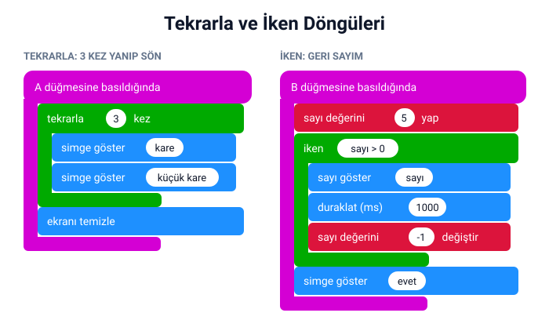

## Bu hafta ne öğreneceğiz?

Bir şarkının nakaratını tekrar söyleriz, egzersizde "10 kez zıpla" deriz. Bilgisayarlar da aynı işi tekrar tekrar yapmakta çok iyidir. Tekrar eden adımlara **döngü** denir. Bu hafta üç çeşit döngüyü öğrenecek, animasyon ve geri sayım yapacağız.

**Malzemeler:** micro:bit v2, USB kablo, bilgisayar.

---

## 1. Döngü nedir?

**Döngü**, bir grup adımı tekrar tekrar çalıştıran yapıdır. Döngü olmasaydı aynı bloğu defalarca alt alta koymak zorunda kalırdık.

**Döngüsüz:** simge göster, simge göster, simge göster, simge göster… (10 kez yaz!)
**Döngüyle:** 10 kez tekrarla → simge göster (bir kez yaz!)

**Günlük hayattan döngüler:**

| Etkinlik | Döngü türü |
| --- | --- |
| Kalbin atması | Hiç durmaz → **sürekli** |
| "10 şınav çek" | Belli sayıda → **tekrarla** |
| "Su kaynayana kadar bekle" | Koşul doğru oldukça → **iken** |

---

## 2. Üç çeşit döngü


| Döngü | Ne zaman durur? | Kategori |
| --- | --- | --- |
| sürekli | Hiç durmaz (kart kapanana kadar) | Temel |
| tekrarla … kez | Yazdığın sayı kadar tekrar edince | Döngüler |
| iken … | Koşul yanlış olunca | Döngüler |

:::tip[Sürekli bloğunu tanıyorsun]
2. haftadan beri kullandığımız **sürekli** bloğu da aslında bir döngüdür!
:::

---

## 3. Proje: Yanıp sönen kare ve geri sayım

**Tekrarla:** A'ya basınca kare ile küçük kare 3 kez yanıp sönsün, sonra ekran temizlensin.

**İken:** B'ye basınca 5'ten geriye saysın; sayı 0'dan büyük oldukça sayıyı gösterip 1 saniye beklesin ve sayıyı 1 azaltsın. Döngü bitince onay simgesi göstersin.



**Düşün:** Geri sayımda "sayı değerini −1 değiştir" bloğunu unutursak ne olur? Sayı hiç azalmaz, koşul hep doğru kalır ve döngü hiç bitmez. Buna **sonsuz döngü** denir.

MicroPython'da `for` (belli sayıda) ve `while` (koşul doğru oldukça) döngüleri vardır:

```python
from microbit import *

while True:
    if button_a.was_pressed():
        for i in range(3):
            display.show(Image.SQUARE)
            sleep(300)
            display.show(Image.SQUARE_SMALL)
            sleep(300)
        display.clear()

    if button_b.was_pressed():
        sayi = 5
        while sayi > 0:
            display.show(sayi)
            sleep(1000)
            sayi -= 1
        display.show(Image.YES)
```

Python'da döngünün içindeki satırlar **girintiyle** (satır başındaki boşlukla) belirlenir. Bloklardaki "içine koyma" işinin Python'daki karşılığı budur.

---

## Kendini dene

1. Yanıp sönme sayısını 3'ten 5'e çıkar ve aradaki bekleme süresini değiştir.
2. Geri sayımı 10'dan başlat ve bitince bir melodi çal.
3. Bir LED'in ekranın üst satırında soldan sağa yürümesini **tekrarla** ve koordinat bloğuyla yap.
4. Sonsuz döngü deneyi: Geri sayımdaki azaltma bloğunu çıkar, simülatörde ne olduğunu gözlemle, sonra hatayı düzelt.

---

## Mini quiz

1. Döngü ne işe yarar?
   a) Adımları tekrar tekrar çalıştırır  b) Rastgele sayı seçer  c) Değişken oluşturur
2. "10 kez zıpla" komutu hangi döngüye benzer?
   a) sürekli  b) tekrarla  c) iken
3. "iken" döngüsü ne zaman durur?
   a) Hiç durmaz  b) Koşul yanlış olunca  c) 4 kez tekrar edince
4. Geri sayımda sayıyı azaltmayı unutursak ne olur?
   a) Döngü hemen biter  b) Sonsuz döngü olur  c) Kart kapanır
5. Hangi blok aslında bir döngüdür?
   a) başlangıçta  b) sürekli  c) simge göster

<details>
<summary>Cevap anahtarı</summary>

1-a · 2-b · 3-b · 4-b · 5-b

</details>

---

## Öğretmen notu

- **1. ders saati:** Döngü kavramı ve "tekrar dansı" ısınması (10 dk), üç döngü türü (15 dk), tekrarla ile yanıp sönen kare (15 dk).
- **2. ders saati:** İken ile geri sayım (15 dk), sonsuz döngü deneyi (5 dk), kendini dene (15 dk), mini quiz (5 dk).
- Isınma önerisi: "3 kez el çırp, sonra zıpla" gibi komutlarla tekrarla döngüsünü; "Ben dur diyene kadar yürü" ile iken döngüsünü bedenle canlandırın.
- Sonsuz döngüyü bilerek yaptırmak, öğrencilerin hatayı tanıyıp düzeltmesini sağlar. Simülatörde yeniden başlat düğmesiyle kolayca çıkılabildiğini gösterin.
- Bu hafta blok döneminin ilk yarısını tamamlıyor. 9. hafta proje haftasında 2–8. haftaların tüm bloklarıyla refleks oyunu yapılacak; öğrencilerden bloklar arasında ne öğrendiklerini kısaca not etmelerini isteyebilirsiniz.
