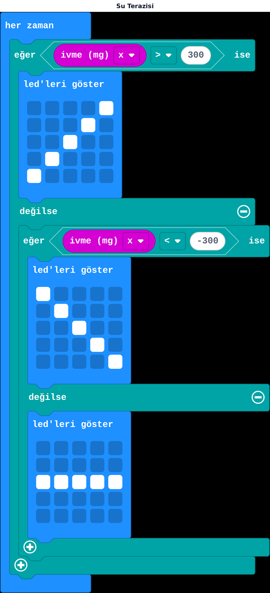

## Bu hafta ne öğreneceğiz?

7. haftada "salla ise" bloğunu kullanmıştık — bu blok, karttaki **ivmeölçer** adlı sensörden geliyordu. Bu hafta ivmeölçeri daha yakından tanıyıp, kartın ne kadar ve hangi yöne eğildiğini **sayı** olarak okuyacağız. Hedefimiz: gerçek bir su terazisi gibi çalışan bir program.

**Malzemeler:** micro:bit v2, USB kablo, bilgisayar.

---

## 1. İvmeölçer nedir?

**İvmeölçer**, kartın hareketini ve eğimini ölçen küçük bir sensördür. micro:bit'te üç yönü ölçer:

| Eksen | Neyi ölçer |
| --- | --- |
| x | Sağa / sola eğim |
| y | İleri / arkaya eğim |
| z | Yukarı / aşağı (yer çekimi yönü) |

Her eksen **ivme (mg)** bloğuyla okunur ve bir sayı döndürür. Kart düz masada dururken x ve y değeri yaklaşık 0'dır; kart sağa yatırılınca x değeri büyür, sola yatırılınca negatif olur.

:::tip[mg nedir?]
"mg" burada gram değil, **miliyerçekimi** birimidir (1000 mg ≈ yer çekiminin tamamı). Sayı büyüdükçe eğim artıyor demektir; tam sayısını ezberlemene gerek yok, önemli olan büyük/küçük/pozitif/negatif karşılaştırmasıdır.
:::

---

## 2. Eğime göre karar vermek

Su terazisi mantığı: x ekseni belli bir sınırı geçerse "sağa yatık", ters sınırı geçerse "sola yatık", aradaysa "düz" say.



**Canlı dene:** <a href="https://makecode.microbit.org/_YppfHXAgDdAW" target="_blank" rel="noopener noreferrer">Bu projeyi MakeCode'da aç</a> ve simülatörde çalıştığını gör.

**her zaman** bloğunda: eğer **ivme (mg) x** > 300 ise sağa yatık çizgi göster, değilse eğer **ivme (mg) x** < -300 ise sola yatık çizgi göster, değilse düz çizgi göster.

Desenleri **led'leri göster** bloğuyla kendin çizersin: düz çizgi ortada yatay, sağa yatık ve sola yatık çizgiler köşegen şeklinde.

---

## 3. Python'da önizleme

MicroPython'da üç eksen de ayrı fonksiyonlarla okunur (25. haftada ayrıntılı göreceğiz):

```python
from microbit import *

while True:
    x = accelerometer.get_x()
    if x > 300:
        display.show(Image.ARROW_E)
    elif x < -300:
        display.show(Image.ARROW_W)
    else:
        display.show(Image.ARROW_N)
```

---

## Kendini dene

1. Eşik değeri 300'den 500'e çıkar; su terazisi daha mı zor yoksa daha mı kolay tetikleniyor?
2. y eksenini de ekleyerek ileri/arkaya eğimi de gösteren bir sürüm yap (örnek: 4 yön).
3. Kart düz tutulduğunda bir melodi, eğri tutulduğunda farklı bir uyarı sesi çalan bir "denge oyunu" yap.
4. "Eğerek kontrol": x eğimine göre ekrandaki bir LED noktasının soldan sağa kaymasını sağla (ipucu: led yak bloğu ve bir koordinat değişkeni).

---

## Mini quiz

1. İvmeölçer neyi ölçer?  
   a) Sıcaklık  
   b) Kartın eğimi ve hareketi  
   c) Ses yüksekliği
2. Kart düz masadayken x ve y değeri genelde nedir?  
   a) 1000  
   b) Yaklaşık 0  
   c) Negatif sonsuz
3. "ivme (mg)" bloğu hangi kategoridedir?  
   a) Girdi  
   b) Müzik  
   c) Matematik
4. Su terazisi kodunda eşik değeri neden gerekir?  
   a) Rastgele sayı üretmek için  
   b) Küçük titremeleri "yatık" saymamak için  
   c) Kartı kapatmak için
5. Hangi blok bu hafta 7. haftadan hatırladığımız bir blok?  
   a) salla ise  
   b) radyo sayı gönder  
   c) pusulayı kalibre et

<details>
<summary>Cevap anahtarı</summary>

1-b · 2-b · 3-a · 4-b · 5-a

</details>

---

## Öğretmen notu

- **1. ders saati:** İvmeölçer kavramı ve üç eksen (10 dk), simülatörde kartı sürükleyip x değerinin değişimini gözlemleme (10 dk), eşik değer mantığı ve su terazisi kodunu kurma (20 dk).
- **2. ders saati:** Kendi LED desenlerini çizme (10 dk), kendini dene 1-2 (15 dk), ileri seviye için 3-4 (15 dk).
- Simülatörde fiziksel kartı sallamak mümkün olmadığından, MakeCode simülatöründeki eğim kaydırıcısı (tilt slider) kullanılır; gerçek kartta öğrenciler karta dokunup gerçek eğimle test etmeli.
- "mg" biriminin tam anlamını (yer çekimi ivmesi) ortaokul seviyesinde derine girmeden, "büyük sayı = çok eğik" olarak basitleştirmek yeterlidir.
- 11. haftada ışık ve sıcaklık sensörleriyle devam ediyoruz — aynı "eşik değer" mantığı tekrar kullanılacak, bu hafta iyi öğrenilirse 11. hafta çok hızlı ilerler.
