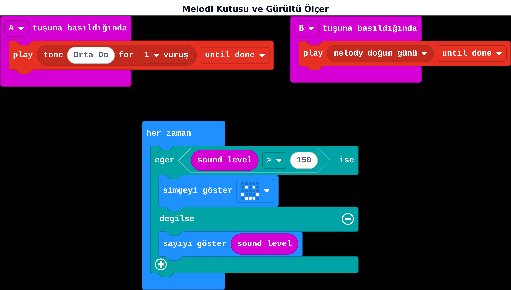

## Bu hafta ne öğreneceğiz?

micro:bit v2'de (v1'den farklı olarak) yerleşik bir **hoparlör** ve bir **mikrofon** var — ek parça takmadan ses çalabilir ve dinleyebiliriz. Bu hafta bir melodi kutusu ve bir gürültü ölçer yapacağız.

**Malzemeler:** micro:bit v2 (hoparlör/mikrofon için v2 şart), USB kablo, bilgisayar.

:::caution[v1 kart ise]
micro:bit v1'de yerleşik hoparlör ve mikrofon yoktur; ses çıkışı için harici bir hoparlör/buzzer bağlamak gerekir. Okulunuzdaki kartların sürümünü (kartın arkasında yazar) kontrol edin.
:::

---

## 1. Hoparlörle ses çalmak

**Müzik** kategorisinde iki temel blok var:

| Blok | Ne yapar |
| --- | --- |
| play tone ... for ... until done | Tek bir notayı, belirttiğin vuruş sayısı kadar çalar |
| play melody ... until done | Hazır bir melodiyi (doğum günü, Nyan Cat gibi) baştan sona çalar |

**play tone** bloğuna frekans olarak doğrudan Hz değeri yazabilir ya da hazır nota bloklarından (**Orta Do** gibi) birini takabilirsin; süre bölümüne de saniye/milisaniye değil, **vuruş** (beat) sayısı yazılır.

**Canlı dene:** <a href="https://makecode.microbit.org/_0T6EKkW8f7Xc" target="_blank" rel="noopener noreferrer">Bu projeyi MakeCode'da aç</a> ve simülatörde çalıştığını gör.

:::note[İngilizce blok]
**Müzik** kategorisindeki bu iki blok da henüz tam çevrilmedi: `play`, `tone`/`melody` ve `until done` İngilizce görünür, sadece nota adları (**Orta Do**), melodi adları (**doğum günü**) ve süre birimi (**vuruş**) Türkçedir. Arayüzde İngilizce kelimeler görsen de ne işe yaradıklarını artık biliyorsun.
:::

**A tuşuna basıldığında:** play tone Orta Do for 1 vuruş until done.
**B tuşuna basıldığında:** play melody doğum günü until done.

---

## 2. Mikrofonla ses seviyesi

Mikrofon bloğu şimdilik Türkçeye çevrilmemiş, İngilizce görünüyor: **sound level** ("ses seviyesi" demek, 0–255 arası bir sayı döndürür — ışık seviyesi bloğuyla aynı mantık).

**her zaman** bloğunda: eğer **sound level** > 150 ise mutlu yüz göster, değilse **sound level** değerini sayı olarak göster.

:::tip[Tanıdık bir desen]
Eşik değerle karar vermek 11. haftadaki ışık sensöründen hatırladığın bir desen. Yeni sensör, aynı mantık!
:::

---

## Kendini dene

1. Eşik değeri 150'den 100'e düşür; gürültü ölçer daha mı hassas oldu?
2. A ve B tuşlarına farklı iki nota ata, kendi küçük "piyanon"u yap.
3. Alkış algılayan bir lamba: ses seviyesi eşiği geçerse bir simge 1 saniye gösterilsin, sonra sönsün.
4. Kendi 4 notalık kısa bir melodini (dört **play tone** bloğu art arda) besteleyip çal.

---

## Mini quiz

1. micro:bit v2'de yerleşik olarak hangi ikisi vardır?  
   a) Kamera ve GPS  
   b) Hoparlör ve mikrofon  
   c) Wi-Fi ve Bluetooth hoparlör
2. Tek bir nota çalmak için hangi blok kullanılır?  
   a) play melody  
   b) play tone  
   c) radyo sayı gönder
3. Mikrofon bloğu MakeCode'da hangi dilde görünür?  
   a) Tamamen Türkçe  
   b) İngilizce (sound level)  
   c) Hiç görünmez
4. sound level değeri kaç ile kaç arasındadır?  
   a) 0–255  
   b) -100–100  
   c) 1–10
5. micro:bit v1'de hoparlör/mikrofon olmaması ne anlama gelir?  
   a) Hiçbir şey, aynı çalışır  
   b) Harici hoparlör/buzzer gerekebilir  
   c) Kart hiç çalışmaz

Cevap anahtarı

1-b · 2-b · 3-b · 4-a · 5-b

---

## Öğretmen notu

- **1. ders saati:** v1/v2 farkını gösterme (kartları kontrol ettirme, 5 dk), play tone ve play melody bloklarını deneme (15 dk), kendi melodiyi besteleme (20 dk).
- **2. ders saati:** Mikrofon ve sound level bloğunu tanıtma (10 dk), gürültü ölçer kodu (15 dk), kendini dene 3-4 (15 dk).
- Sınıf ortamı gürültülüyse sound level eşiğini yüksek tutmak gerekir; öğrencilerin simülatörde test edip gerçek kartta tekrar ayarlaması öğretici bir deneyimdir.
- Kulaklık/hoparlör ses seviyesini düşük tutun; 30 kart aynı anda melodi çalarsa sınıf gürültülü olur — gruplar hâlinde sırayla test ettirmek önerilir.
- 14. haftada radyo ile kartlar arası iletişime geçiyoruz; bu, blok döneminin en "takım çalışması" gerektiren konularından biri.
