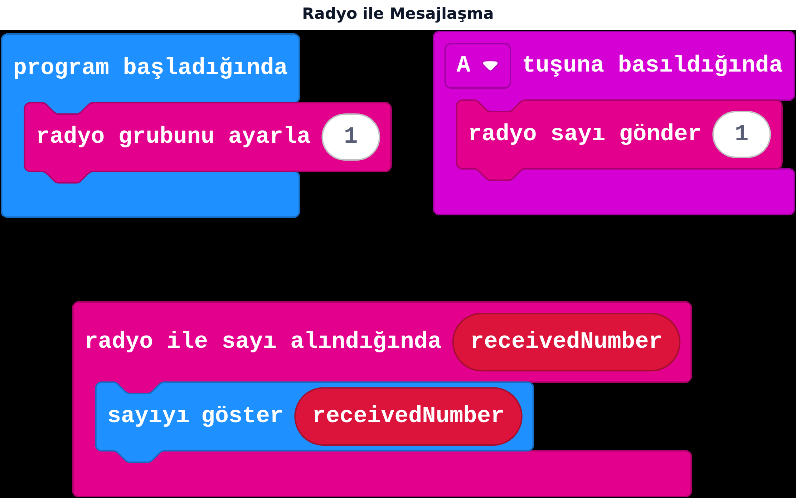

## Bu hafta ne öğreneceğiz?

micro:bit'lerin bir süper gücü var: **radyo** ile birbirlerine kablosuz mesaj gönderebilirler (Bluetooth değil, kendi radyo sistemleri — menzili sınıf içinde fazlasıyla yeterli). Bu hafta iki kartı birbiriyle "konuşturacağız".

**Malzemeler:** 2 adet micro:bit v2 (çift başına), 2 USB kablo, bilgisayar. (Tek kartla da denenebilir ama tam etkisini görmek için iki kart gerekir.)

---

## 1. Radyo grubu

Sınıftaki herkes aynı anda radyo kullanınca, kartların birbirine karışmaması için bir **grup numarası** gerekir — tıpkı farklı WiFi ağları gibi. Aynı gruptaki kartlar birbirini duyar, farklı gruptakiler duymaz.

**radyo grubunu ayarla** bloğu, genelde **program başladığında** içine konur. Sınıfta her ikili farklı bir grup numarası (1, 2, 3...) seçmeli.

:::tip[Grup numarası = kanal]
Grup numarasını bir telsiz kanalı gibi düşün: aynı kanaldakiler birbirini duyar.
:::

---

## 2. Gönderen ve alan: iki farklı kod

Radyo projelerinde **iki karta da aynı kod yüklenmez.** Her kart farklı bir rol oynar:



**Canlı dene:** <a href="https://makecode.microbit.org/_hmw2qWf5qJts" target="_blank" rel="noopener noreferrer">Bu projeyi MakeCode'da aç</a> ve simülatörde çalıştığını gör.

**Gönderen kart:** program başladığında radyo grubunu ayarla 1; A tuşuna basıldığında **radyo sayı gönder** 1.
**Alan kart:** program başladığında radyo grubunu ayarla 1 (**gönderenle aynı numara**); **radyo ile sayı alındığında** (`receivedNumber`) → sayıyı göster `receivedNumber`.

:::note[İngilizce kalan parametre adı]
"radyo ile sayı alındığında" olayının mesajı tuttuğu değişken otomatik olarak **receivedNumber** adıyla gelir, bu kısım Türkçeye çevrilmedi. İstersen bu değişkenin adını değiştirebilirsin (değişken adına tıkla, yeniden adlandır).
:::

| Gönderilen veri türü | Blok |
| --- | --- |
| Sayı | radyo sayı gönder |
| Metin | radyo dizgi gönder |
| Alma (her ikisi için) | radyo ile sayı/dizgi alındığında |

:::caution[En sık hata: grup numarası uyuşmazlığı]
İki kart farklı grup numarasına ayarlanmışsa mesaj hiç ulaşmaz. **Grup ayarı bloğu sadece gönderen karta değil, iki karta da eklenmeli** — alıcı grup ayarını hiç yapmazsa varsayılan grup olan 0'da kalır. İlk denemede çalışmazsa önce grup numaralarını kontrol edin.
:::

---

## 3. Metin gönderme

Sayı yerine bir kelime göndermek istersen **radyo dizgi gönder** bloğunu kullanırsın; alan kartta da **radyo ile dizgi alındığında** bloğu bu metni yakalar.

```
Gönderen: radyo dizgi gönder "Merhaba"
Alan: radyo ile dizgi alındığında (receivedString) → dizgi göster receivedString
```

---

## Kendini dene

1. İki kartı aynı gruba ayarlayıp A tuşuyla bir sayı, B tuşuyla farklı bir sayı gönder.
2. Metin gönderen bir sürüm yap: A'ya basınca "Selam", B'ye basınca "Görüşürüz" gönder.
3. Gelen mesaja göre farklı simge gösteren bir "ruh hâli bildirici" yap (örnek: "mutlu" gelirse mutlu yüz).
4. Yanlışlıkla iki ekibi aynı gruba ayarlayıp ne olduğunu gözlemle, sonra düzelt — bu, grup numarasının neden önemli olduğunu gösterir.

---

## Mini quiz

1. Radyo grubu neden gereklidir?  
   a) Pil tasarrufu için  
   b) Kartların birbirine karışmaması için  
   c) Zorunlu değildir
2. Gönderen ve alan karta aynı kod mu yüklenir?  
   a) Evet, her zaman aynı  
   b) Hayır, genelde farklı rol/kod gerekir  
   c) Kod hiç gerekmez
3. Sayı göndermek için hangi blok kullanılır?  
   a) radyo dizgi gönder  
   b) radyo sayı gönder  
   c) radyo grubunu ayarla
4. İki kart mesajlaşmıyorsa ilk kontrol edilmesi gereken şey nedir?  
   a) Pil seviyesi  
   b) Grup numaraları aynı mı  
   c) Ekran parlaklığı
5. Radyo, micro:bit'lerde hangi teknolojiyle çalışır?  
   a) Bluetooth  
   b) Kendi radyo sistemi (2.4 GHz)  
   c) WiFi

<details>
<summary>Cevap anahtarı</summary>

1-b · 2-b · 3-b · 4-b · 5-b

</details>

---

## Öğretmen notu

- **1. ders saati:** Radyo kavramı ve grup numarası (10 dk), ikili gruplara ayırma ve kendi grup numaralarını seçtirme (5 dk), gönderen/alan kodunu birlikte kurma (25 dk).
- **2. ders saati:** Metin gönderme (10 dk), kendini dene 1-3 (20 dk), grup numarası hatası deneyi (10 dk).
- Bu hafta mutlaka ikili/grup çalışması olarak planlanmalı; her öğrencinin kendi kartında hem gönderen hem alan kodunu ayrı ayrı denemesi daha iyi öğrenme sağlar.
- Sınıfta birden fazla ikili aynı anda çalışırsa farklı grup numaraları seçmelerini önceden planlayın (örnek: her sıraya bir numara).
- 15. hafta bu temeli büyütüp çok kartlı iletişime ve sinyal gücüne geçecek.
