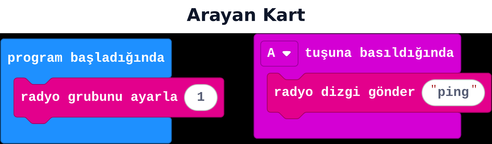
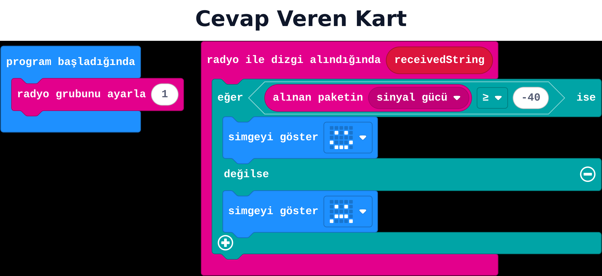

## Bu hafta ne öğreneceğiz?

14. haftada iki kart arasında mesajlaştırdık. Bu hafta aynı fikri **sınıf çapına** büyütüyoruz: tüm kartlar aynı gruba girip birbirini dinleyebilir. Ayrıca gelen mesajın ne kadar "güçlü" (yakın) olduğunu ölçen **sinyal gücü** bilgisini kullanacağız.

**Malzemeler:** Sınıftaki kadar micro:bit v2, USB kablolar, bilgisayarlar.

---

## 1. Çok kartlı iletişim

14. haftadaki gönderen/alan ayrımı burada da geçerli, tek fark: **aynı gruba giren herkes aynı mesajı alır.** Bu, bir sınıf oylama sistemi için idealdir — bir "toplayıcı" kart tüm "oy veren" kartlardan gelen sayıları toplar.

| Rol | Kod |
| --- | --- |
| Oy veren kartlar (herkes) | A'ya basınca 1, B'ye basınca 2 gönder |
| Toplayıcı kart (öğretmen) | Gelen her sayıyı bir değişkene ekleyip göster |

:::tip[Gerçek bir sınıf oylaması]
Toplayıcı kart "radyo ile sayı alındığında" içinde bir sayaç değişkenini 1 artırırsa, kaç kişinin oy verdiğini sayabilirsin. Hangi seçeneğin kaç oy aldığını saymak için 16. haftadaki listeleri kullanmak gerekir — şimdilik basit bir toplam sayı yeterli.
:::

---

## 2. Sinyal gücü nedir?

Bir mesaj alındığında, o mesajın ne kadar "güçlü" geldiğini gösteren bir değer de ölçülür: **alınan paketin sinyal gücü**. Bu değer negatiftir; **0'a yakın** (örnek: -30) güçlü/yakın sinyal, **çok küçük/negatif** (örnek: -90) zayıf/uzak sinyal demektir.

**Canlı dene:** <a href="https://makecode.microbit.org/_RduF6pDzz9XL" target="_blank" rel="noopener noreferrer">Bu projeyi MakeCode'da aç</a> ve simülatörde çalıştığını gör.

**Canlı dene:** <a href="https://makecode.microbit.org/_Tmg4CL84fKYz" target="_blank" rel="noopener noreferrer">Bu projeyi MakeCode'da aç</a> ve simülatörde çalıştığını gör.

**Arayan kart:** program başladığında radyo grubunu ayarla 1; A tuşuna basıldığında radyo dizgi gönder "ping".
**Cevap veren kart:** program başladığında radyo grubunu ayarla 1 (**arayanla aynı numara**); radyo ile dizgi alındığında (`receivedString`) → eğer **alınan paketin sinyal gücü** ≥ -40 ise mutlu yüz (yakın/sıcak), değilse üzgün yüz (uzak/soğuk).

:::caution[Sinyal gücü kesin mesafe değildir]
Duvarlar, insanlar ve diğer kartlar sinyali etkiler. "Sıcak-soğuk" oyunu için yeterince iyi çalışır ama santimetre hassasiyetinde bir mesafe ölçer değildir.
:::

---

## Kendini dene

1. "ping" gönderen kartı elinde tutup sınıfta dolaş, cevap veren kartın ne zaman mutlu/üzgün yüze döndüğünü gözlemle.
2. Sinyal gücü eşiğini -40'tan -60'a değiştir; oyun daha mı kolay oldu?
3. Basit bir sınıf oylaması kur: 3-4 kart A'ya basınca 1, B'ye basınca 2 gönderir; bir "toplayıcı" kart gelen her sayıyı ekranda gösterir.
4. Sinyal gücünü sayı olarak da gösterecek bir hata ayıklama (debug) ekranı ekle — bu, "görünmeyen" bir değeri görünür kılmanın iyi bir yoludur.

---

## Mini quiz

1. Aynı gruptaki birden fazla kart mesaj gönderirse kim alır?  
   a) Sadece ilk kart  
   b) Aynı gruptaki herkes  
   c) Hiç kimse
2. Sinyal gücü değeri genelde nasıldır?  
   a) Pozitif ve büyük  
   b) Negatif bir sayı  
   c) Her zaman sıfır
3. Sinyal gücü 0'a yakınsa (örnek -20) ne anlama gelir?  
   a) Kartlar birbirine yakın/sinyal güçlü  
   b) Kartlar çok uzak  
   c) Pil bitmiş
4. Sinyal gücü neden "kesin" bir mesafe ölçer değildir?  
   a) Hiçbir sebep yok, kesindir  
   b) Duvar/insan gibi engeller sinyali etkiler  
   c) Sadece gece çalışır
5. Sınıf oylama sisteminde "toplayıcı" kartın görevi nedir?  
   a) Hiçbir şey yapmaz  
   b) Gelen mesajları toplayıp göstermek  
   c) Sadece melodi çalmak

Cevap anahtarı

1-b · 2-b · 3-a · 4-b · 5-b

---

## Öğretmen notu

- **1. ders saati:** Çok kartlı iletişim fikri ve toplayıcı/gönderen rol ayrımı (10 dk), basit sınıf oylaması kurulumu (25 dk).
- **2. ders saati:** Sinyal gücü kavramı (10 dk), sıcak-soğuk oyunu kodu (15 dk), sınıfta gerçek mesafeyle test (15 dk).
- Sıcak-soğuk oyunu sınıf dışında (koridor, bahçe) daha etkili test edilir; sınıf içinde duvarlara yakın yerlerde sinyal garip davranabilir, bu durumu "gerçek sensörlerin sınırları" dersi olarak kullanın.
- Çok kart aynı anda radyo kullanınca mesajlar bazen çakışabilir (kaybolabilir); bu normal, "radyo da mükemmel değil" diye açıklayın.
- Bu hafta blok döneminin radyo konusunu tamamlıyor; 16. haftada fonksiyonlar ve listelerle kod tekrarını azaltmayı öğreneceğiz.
