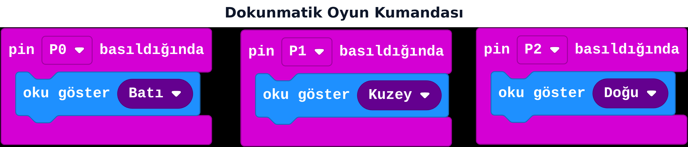

## Bu hafta ne öğreneceğiz?

Kartın alt kenarındaki üç metal nokta — **P0, P1, P2** — hem devre bağlamak için kullanılır hem de doğrudan **dokunmatik düğme** gibi çalışır. Bu hafta A ve B düğmelerinde öğrendiğimiz "olaya tepki ver" mantığını üç pine taşıyacağız.

**Malzemeler:** micro:bit v2, USB kablo, bilgisayar.

---

## 1. Pinler de birer düğmedir

4. haftada **A tuşuna basıldığında** ve **A tuşu basılı mı** bloklarını öğrenmiştik. Pinler için aynı ailede bloklar var:

| Blok | Ne yapar |
| --- | --- |
| pin P0 basıldığında | P0'a dokununca bir kere çalışır (olay) |
| pin P0 basılı mı | P0'a şu an dokunuluyor mu diye sorar (koşul) |
| pin P0 bırakıldığında | Dokunma bitince bir kere çalışır (olay) |

P0 yerine P1 veya P2 de seçilebilir — mantık tamamen aynı.

:::tip[Nasıl dokunulur?]
Parmağını doğrudan pine dokundurman yeterlidir; vücudun küçük bir elektrik devresi tamamlar. Bazı kartlarda daha iyi çalışması için aynı anda GND (toprak) pinine de dokunmak gerekebilir — kartının el kitabına bakın.
:::

---

## 2. Dokunmatik oyun kumandası

**Canlı dene:** <a href="https://makecode.microbit.org/_V0Md8UagsACs" target="_blank" rel="noopener noreferrer">Bu projeyi MakeCode'da aç</a> ve simülatörde çalıştığını gör.

**pin P0 basıldığında:** ok göster Batı (sol).
**pin P1 basıldığında:** ok göster Kuzey (yukarı).
**pin P2 basıldığında:** ok göster Doğu (sağ).

:::note[ok göster bloğu]
Yön oku için **simgeyi göster** değil, ayrı bir **ok göster** bloğu kullanılır — açılır listeden Kuzey/Güney/Doğu/Batı (ve aralarındaki yönler) seçilir.
:::

Üç pin, üç yön tuşu gibi davranıyor — basit bir oyun kumandasının temeli bu kadar!

---

## Kendini dene

1. Her pine farklı bir ses (ton çal) ata; üç pinle küçük bir "piyano" yap.
2. P0 ve P2'ye aynı anda dokunulduğunda (iki **... basılı mı** koşulunu **ve** ile birleştirerek) özel bir simge göster.
3. Bir "basılı tut" oyunu: P1'e en uzun basılı tutan skor kazanır (ipucu: pin basılı mı koşulunu her zaman içinde sayaç ile kullan).
4. 9. haftadaki refleks oyununu A/B düğmeleri yerine pinlerle yeniden yap.

---

## Mini quiz

1. P0, P1, P2 pinleri neyle aynı mantıkta çalışır?  
   a) Radyo bloklarıyla  
   b) A/B düğmeleriyle  
   c) Pusula bloklarıyla
2. "pin P0 basıldığında" ne zaman çalışır?  
   a) Sürekli  
   b) P0'a dokunulduğu anda bir kere  
   c) Kart açıldığında
3. Pine dokunarak girdi almak için ekstra bir devre elemanı gerekir mi?  
   a) Her zaman gerekir  
   b) Hayır, doğrudan parmakla dokunulabilir  
   c) Sadece pille çalışır
4. Üç pinle basit bir oyun kumandası yapmak için hangi yapı kullanılır?  
   a) Üç ayrı "pin basıldığında" olayı  
   b) Tek bir her zaman döngüsü  
   c) Radyo grubu
5. P0 yerine P1 kullanmak kodu nasıl değiştirir?  
   a) Hiçbir fark yok, mantık aynı, sadece pin ismi değişir  
   b) Tamamen farklı bir blok ailesi gerekir  
   c) Mümkün değildir

Cevap anahtarı

1-b · 2-b · 3-b · 4-a · 5-a

---

## Öğretmen notu

- **1. ders saati:** Pinlerin fiziksel olarak gösterilmesi (kartın altını inceletme, 5 dk), dokunma denemesi ve "basıldığında" olayını kurma (20 dk), üç pinli kumandayı tamamlama (15 dk).
- **2. ders saati:** Ses/piyano denemesi (15 dk), kendini dene 2-4 (25 dk).
- Bazı öğrencilerde (kuru cilt, statik elektrik) dokunma algılama zayıf çalışabilir; GND pinine aynı anda dokunmayı veya elleri hafif nemlendirmeyi önerin.
- Bu hafta blok döneminin **son yeni konusu**; 18. hafta genel bir proje/tekrar haftası olacak.
- Pinlerle ilgili güvenlik notu: sadece kartın kendi pinlerine dokunulmalı, harici güç kaynaklarıyla pin birleştirilmemeli.
